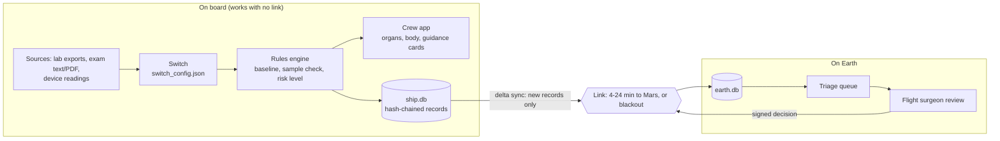

# Space Health

**The crew acts now. Earth confirms later.**

Offline-first health monitoring for crews on long space missions. Built for the NASA Space Apps Challenge 2026, challenge *Create Health Monitoring Software for Astronauts on Space Missions*, by a team at the Fortaleza (Brazil) local event.

> Prototype for a hackathon. **Not a medical device.** Guidance texts and alert limits are examples that flight medicine staff would have to set and review.

## Run it

Requirements: **Python 3.10+** (standard library only) and **Node.js 18+**.

**Windows:** double-click `start.bat`. It installs the app on the first run, starts the API and the app, and opens http://localhost:5174.

**Any system**, two terminals:

```bash
# 1. API on http://127.0.0.1:8000 (creates the demo databases on first run)
cd backend
python server.py              # Windows: py -3 server.py

# 2. App on http://localhost:5174
cd app
npm install
npm run dev
```

The sign-in screen lists the demo people: tap one to enter, no password needed. (The API still issues a token per user; the app sends the demo PIN, `2026`, for you.)

| Person | Role | Screen |
| --- | --- | --- |
| `C003` (also `C001`, `C002`, `C004`) | Crew member, real NASA blood data | Health, Mission, Companion |
| `cmo` | Crew Medical Officer, on board | Health, Mission, Companion |
| `surgeon` | Flight Surgeon, on Earth | Mission control (triage and review) |

Open two windows side by side, one as `C003` and one as `surgeon`. Smartwatch face: sign in as a crew member and open `#/watch`.

**One process instead of two:** `cd app && npm run build`, then `python backend/server.py` also serves the app at http://127.0.0.1:8000.

**Reset the demo:** `python backend/reset_demo.py`.

**Other devices (tablet, phone, watch):** start the API with `SPACE_HEALTH_HOST=0.0.0.0` and enter `http://<laptop-ip>:8000` under *Settings → Ship server* on the sign-in screen. Android and iOS builds use Capacitor: `npm run android` or `npm run ios` inside `app/` (Android Studio or Xcode required).

## What it does

On the way to Mars an answer from Earth can take up to 48 minutes round trip, and sometimes there is no link at all. Space Health lets the astronaut understand a result and act on board, then lets a flight surgeon on Earth review and sign what happened when the link allows.

| On board (crew screen) | On Earth (mission control) |
| --- | --- |
| Organs and a 3D body coloured by the most serious open item per system | Triage queue: who needs attention first |
| Guidance cards: what was measured, how it compares with *your own* pre-flight baseline, what to do now, who decides, the source | The same cards, plus the full findings table |
| Symptom report by body region, intensity, onset and duration | Approve, reject or send a directive to the crew |
| Works with no link: the last data stays on the device and new records wait in an outbox | Delayed delivery: a directive arrives after the simulated light time |
| Companion: questions answered from sourced protocols, plus an "I need help now" button | Emergency words reach the ground as a RED alert |
| Installable app (PWA) that works offline; Android and iOS through Capacitor | |

## The four ideas that matter

1. **Personal baseline, not only the lab range.** Each value is compared with the mean of the crew member's pre-flight draws. A value outside the lab range but normal for that person is logged, not alarmed; a value inside the range but far from the person's normal is flagged.
2. **Crew-wide sample check.** When half or more of the crew deviate the same way, on the same analyte, in the same draw, the system reports a *possible sample-handling problem or shared cause* and asks for a repeat, instead of raising several emergencies. In the real NASA data below, this rule fires exactly twice.
3. **Autonomy by risk level.** Routine items are handled by the astronaut; items that need attention can be acted on immediately and are queued for ground review; critical items also call the Crew Medical Officer. The number, the level and the steps are identical on the crew and ground screens.
4. **Triage by rate of change.** `urgency = (100 - score) + 3.5 x drop per day`, with single-value red flags ranked above everything, as in hospital early-warning scores (NEWS2). A drop from 100 to 90 in one day (urgency 45) outranks a drift from 98 to 90 over four days (13.5).

## What we found in NASA data

We ran the engine on **NASA OSDR OSD-575**, the comprehensive metabolic panel of the four SpaceX Inspiration4 crew members (crew IDs C001 to C004): 531 rows, 19 analytes, 7 draws from 92 days before launch to 194 days after return.

- 28 of 453 numeric values fall outside the laboratory reference range, and **13 of those are pre-flight**. A fixed reference range alone would alarm on healthy people before they fly.
- At the draw 45 days after return, **three of four crew members show glucose of 36 to 44 mg/dL**; at the next draw all four are between 77 and 91 mg/dL. Three severe lows in one draw are unlikely. The pattern is consistent with delayed sample processing (cells keep consuming glucose in the tube), but we cannot confirm the cause from public data. Space Health flags this draw as a possible sample problem.

Inspiration4 flew for three days and this file has only pre-flight and post-flight draws, so we use it as a realistic longitudinal series to test the engine, not as evidence about long-duration flight.

## How it works



- `backend/clinical_rules.py` is the deterministic engine. Same input, same output; every threshold is in `switch_config.json` and every guidance text in `knowledge_base.json`, each with a source. Entries without a source are ignored.
- `backend/exam_parser.py` reads PDFs, spreadsheets and plain text, converts units and refuses implausible values.
- `backend/database_manager.py` keeps `ship.db` and `earth.db`, the delta sync, the uplink queue with delivery delay, the review flow, encryption at rest and the hash chain.
- `backend/assistant.py` answers only from sourced protocol entries, with guardrails for emergencies and medication questions.
- `backend/server.py` is the HTTP API (standard library). Roles come from the user record on the server: CREW, CREW_MEDICAL_OFFICER, FLIGHT_SURGEON.
- `app/` is the React + TypeScript app (PWA, Capacitor for Android and iOS, three.js for the 3D body).

No generative model makes clinical decisions. That is deliberate: in a medical context an auditable rule set is easier to check and to approve.

## What is real and what is simulated

| Real | Simulated, and labelled on screen |
| --- | --- |
| Blood chemistry of C001 to C004 (NASA OSDR OSD-575) | Crew members "Alex", "Elena" and "Marcus" and their data |
| Rules engine, cards, triage, review flow | Suit vitals and cabin readings |
| Two databases, delta sync, hash chain, encryption at rest | Link delay (1 minute of light time shown as 1 second) |

## API

| Method and path | Who | What |
| --- | --- | --- |
| `GET /api/users`, `POST /api/login` | anyone | User list for sign-in; `{userId, pin}` returns a token |
| `GET /api/crew/state` | crew, CMO | Cards, body map, vitals, history, symptoms, link |
| `POST /api/symptoms` | crew, CMO | Symptom report |
| `POST /api/cards/step` | crew, CMO | Marks a guidance step as done |
| `POST /api/exams/analyze` | crew, CMO | `{filename, content}` text, PDF or data URI |
| `POST /api/exams/load-draw` | crew, CMO | `{draw: "R+45"}` loads a real OSD-575 draw for the whole crew |
| `POST /api/sync/downlink` | crew, CMO | Sends records not yet synced; 409 during a blackout |
| `GET /api/ground/state` | flight surgeon | Triage queue, review items, sync log |
| `POST /api/governance/decide` | flight surgeon | `{govId, decision, humanDirective}` |
| `GET, POST /api/link` | signed in | Link profile and blackout |
| `GET /api/audit/verify?db=ship` | signed in | Recomputes the hash chain |
| `POST /api/v1/ingest` | device key | Readings from a machine (`X-Device-Key`) |
| `GET /api/v1/schema` | anyone | Device contract, no data |
| `GET /api/assistant/status`, `POST /api/assistant/ask` | crew, CMO | Question answered from sourced protocols |

## Limits

- Prototype. Not validated clinically. Red-flag limits and personal-baseline tolerances are example values.
- The payload cipher is a standard-library demonstration, not production cryptography; a real system would use AES-256-GCM and managed keys. The hash chain is real.
- The assistant is not a doctor. It covers only what its sourced corpus covers and says so otherwise.
- The demo runs over plain HTTP on a local network; a real deployment needs TLS.

## Data and sources

- NASA OSDR, study OSD-575 (Inspiration4 comprehensive metabolic panel): https://osdr.nasa.gov/bio/repo/data/studies/OSD-575. File `LSDS-8_Comprehensive_Metabolic_Panel_CMP.upload_SUBMITTED.csv`, downloaded 2026-11-15, SHA-256 `dab247eb794edab59aaaa683c85fd1f2dbf4ae3684872739338e10ead4192a0c`.
- Overbey et al., *Nature Communications* 2024, Inspiration4 sample collection schedule: https://doi.org/10.1038/s41467-024-48806-z
- NASA, Mars communication delay of 4 to 24 minutes one way: https://www.nasa.gov/solar-system/space-communications-7-things-you-need-to-know/
- NASA NTRS 20230001079, in-flight blood analysis demonstration: https://ntrs.nasa.gov/citations/20230001079
- Royal College of Physicians, NEWS2: https://www.rcp.ac.uk/resources/national-early-warning-score-news-2/
- HuBMAP CCF 3D Reference Object Library v1.2 (3D body and organs, CC BY 4.0): https://humanatlas.io
- Guidance sources are listed per entry in `backend/knowledge_base.json` (CDC, MedlinePlus, NCI Biospecimen Research Database) and `backend/knowledge/space_protocols.json` (NASA NTRS 20040089364, 20160012725, 20150019624, 20220000516; NASA OCHMO-TB-004; RCP NEWS2).
- Space Apps Participant Terms (third-party materials): https://www.spaceappschallenge.org/legal/

## Use of AI

Parts of the source code and of this documentation were written with AI coding assistants (including Claude by Anthropic) and reviewed and tested by the team. The product itself makes no clinical decision with a generative model: tiers, cards, scores and triage are fixed rules. No AI-generated images, video or audio are used.

## License

Space Health is released under the Apache License 2.0 (`LICENSE`). Third-party materials, their licenses and the sources we cite are listed in [THIRD_PARTY_NOTICES.md](THIRD_PARTY_NOTICES.md).

## Repository layout

```
start.bat         Windows launcher (API + app + browser)
backend/          API, rules engine, assistant; databases are created at run time
  data/           NASA OSDR OSD-575 CSV
  knowledge/      sourced protocol entries for the assistant
app/              React + TypeScript app (PWA, Android and iOS through Capacitor)
  src/views/      Login, Crew (Health, Mission), Companion, Ground, Watch
  public/models/  3D body (HuBMAP, CC BY 4.0)
```
